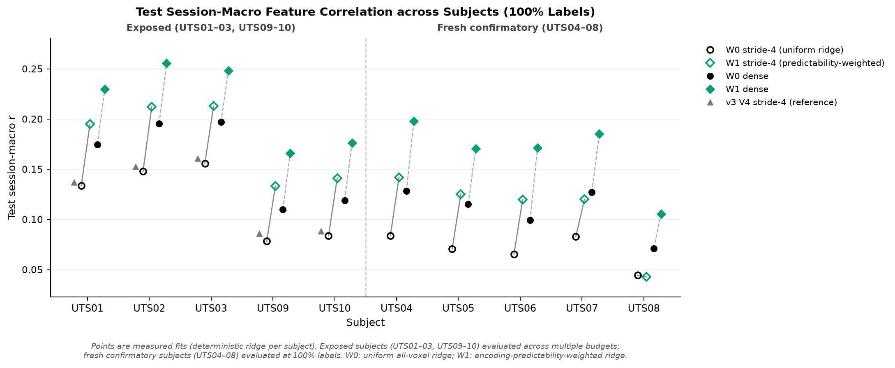

# SSLTang

Does self-supervised pretraining on naturalistic fMRI help decode what a listener hears? This repository tests
that on the Huth-lab story-listening data ([OpenNeuro ds003020](https://openneuro.org/datasets/ds003020)), with
transfer checks on imagined speech and silent movies ([ds004510](https://openneuro.org/datasets/ds004510)).
Decoders predict frozen GPT-2 layer-9 embeddings (768-d, 20-word causal context) from BOLD responses. They do not
generate text.

Every study was registered before its test scores were read. The protocols are in [`experiments/`](experiments).

## Results

**Short answer: no.** Self-supervised pretraining did not improve semantic decoding on these data. The large,
replicated gains came from using the supervision better: dense training targets and an encoding-weighted voxel
prior on a linear decoder. For UTS01, test r rose from 0.122 (v2 ridge) to 0.230 (dense W1).

| Study | Question | Outcome |
|---|---|---|
| [v1](results/comparison/RESULTS.md) | Masked-reconstruction SSL vs. random init, 5 label budgets, UTS01 | 100% labels: r 0.053 → 0.069. Near zero at 5% and 1%. Transfer mixed ([table](results/transfer_comparison/RESULTS.md)). |
| [v2](results/v2/REPORT.md) | Linear baselines, latent (EMA) vs. reconstruction objectives, 3 subjects | Ridge on raw BOLD (r 0.122 / 0.137 / 0.143) beat every SSL encoder. Latent prediction did worse than reconstruction, and pretrained encoders were no better than random frozen ones. |
| [v3](results/v3/REPORT.md) | Structured multi-kernel ridge, dense vs. stride-4 training | Structured prior +0.004 (3/3). Dense training r 0.179 / 0.200 / 0.200 (about +30%). Replicated in 2 fresh subjects. |
| [v3 §12](results/v3w/REPORT.md) | Weight each voxel by its training-only encoding score | +0.055 to +0.064 test r in 5/5 exposed subjects. Confirmed in 4/5 fresh subjects (UTS04–08). Dense W1: **0.230 / 0.255 / 0.248**. |
| v4 (in progress, [protocol](experiments/PROTOCOL_V4.md)) | Empirical-Bayes and cross-subject voxel priors; LPP dataset check | LPP checks pass 9/9 ([g4](results/v4_lpp/g4.json)). EB fails its gate. PRIOR advances (+0.0055 over W1 on validation, [gates](results/v4/gates.json)). No test scores yet. |

All correlations are session-macro test Pearson r on held-out stories for UTS01 / UTS02 / UTS03 unless noted.



## Layout

- `src/`: data, models, SSL objectives, ridge decoders, voxel priors, evaluation
- `scripts/`: download, preprocessing, target extraction, study runners, summaries and plots
- `configs/`: study configs. `huth_session_map.json` assigns sessions to splits.
- `experiments/`: registered protocols, data/feature/model contracts, the v3 locks and the download manifests
- `results/`: reports, tables, figures and gate decisions (no per-run predictions or checkpoints)
- `tests/`: CPU tests on synthetic data

## Setup

Python 3.12+ and a CUDA GPU. One study used at most 0.6 GiB of training VRAM, but the dense ridge fits want a large GPU.

```bash
python -m venv .venv && source .venv/bin/activate
pip install -r requirements.txt && pip install -e .
bash scripts/fetch_references.sh   # pinned Tang/Huth reference code into reference/ (needed by some tests)
pytest -q
```

## Reproducing v1 (UTS01)

```bash
python scripts/download_data.py --root data/raw --mode train --subject UTS01 \
  --manifest experiments/sources/download_ds003020_UTS01.json --workers 4
python scripts/preprocess.py --root data/raw --out data/processed/UTS01 --mode train --subject UTS01 \
  --block-size 4 --session-map configs/huth_session_map.json --seed 42
python scripts/build_semantic_targets.py --manifest data/processed/UTS01/manifest.json \
  --output-dir data/semantic/UTS01 --device cuda --batch-size 256
python scripts/run_experiments.py --stage ssl --seeds 17 23 47
python scripts/run_experiments.py --stage milestone --seeds 17 23 47
python scripts/run_experiments.py --stage labels --seeds 17 23 47
python scripts/plot_results.py --runs results/runs --out results/comparison
```

For transfer, download with `--mode transfer` and the ds004510 manifest. Preprocess with the training split's
normalization (`--normalization data/processed/UTS01/normalization.npz`), then run `scripts/run_transfer_study.py`
and `scripts/plot_transfer_results.py`. Each later study has its own runner (`run_phase_*.py`, `run_v3*.py`,
`run_v4*.py`) and summarizer, described in its protocol.

## Notes

- The splits keep sessions apart: 61 train, 11 validation and 11 test stories for UTS01.
- The GPT-2 target model is pinned to revision `607a30d`. It is not the original Huth-lab GPT checkpoint.
- The transfer references are coarse: imagined-speech cues and descriptive movie scripts, scored by run-level
  retrieval. With five narratives and three films, they cannot support a strong transfer claim.
